# Revisión pedagógica independiente

Fecha: 28 de octubre de 2026. Alcance: `index.html`, `content.mjs`, `app.mjs`, `styles.css` y doce capturas reales de la implementación. Revisión centrada en enseñar a comunicar una intención mediante inglés, con apoyo visual y práctica de recuperación.

**Dictamen: apta para publicar como una masterclass de una conversación concreta.** La lección enseña un mapa reutilizable —patrón anterior, cambio y balance hasta hoy— y lo lleva de la escucha a la producción. Las correcciones prioritarias detectadas durante esta revisión están incorporadas. No quedan errores lingüísticos que bloqueen esta entrega dentro del contenido revisado.

## Criterios logrados

| Criterio | Evidencia y valoración |
|---|---|
| Uso e intención antes que traducción | Las escenas preguntan qué quieres comunicar y qué entiende tu colega. No se exige convertir una oración española palabra por palabra. El español explica la situación y el efecto de las elecciones. |
| Progresión | Escucha con respuesta oculta → interpretación global y detalle auditivo → seis piezas con intención → contraste visual → ocho decisiones → respuesta oral con y sin apoyo. |
| Imágenes con función | Las repeticiones representan incidentes; los corchetes sitúan esos incidentes dentro de una etapa; la línea termina en NOW; el tanque vacío y la barra que alcanza el tope distinguen recurso agotado de límite alcanzado. Las imágenes aportan relaciones, no solo ambiente. |
| Feedback recuperable | Al equivocarse, el alumno recibe una explicación de la historia que cuenta su opción y puede volver a elegir. La respuesta incorrecta queda visible; no hay castigo de puntuación que desplace la atención del significado. |
| Transferencia | La arquitectura aparece en batería, rutina y horario. La sección oral también permite una respuesta breve cuando el interlocutor ya conoce el contexto. |
| Recuperación | El modelo comienza cerrado. La práctica oral exige reconstruir la idea, permite detenerse sin convertir el tiempo en un examen e invita a volver en 1, 3 y 7 días. |
| Autoevaluación honesta | Las casillas comprueban funciones comunicativas y uso de apoyo. Se aclara que no hay evaluación automática de pronunciación ni certificación de fluidez. Abrir el modelo después del intento permite comparar sin invalidar la independencia previa. |

## Precisión de las seis piezas

| Fragmento | Resultado de la revisión |
|---|---|
| `I used to run out…` | Correcto para presentar el patrón pasado en contraste con la situación actual. Se distingue de un episodio de ayer y de `I'm used to…`. `Pretty often` no se presenta como siempre. |
| `when I was using Fable` | Correcto como marco de una etapa. La explicación evita la falsa regla de que todo pasado continuo requiere una interrupción. |
| `I'd hit…` | Correcto como `I would hit` habitual dentro del contexto ya abierto. Se advierte que la contracción puede tener otra lectura y que `both` no implica simultaneidad ni todos los días. |
| `since switching…` | Correcto para abrir el período desde el cambio hasta hoy. Se ofrece `since I switched` como alternativa y se distingue el punto de partida de una duración con `for`. |
| `I've been fine` | Correcto como balance de la experiencia reciente dentro de este contexto. La lección evita presentarlo como garantía de futuro o como afirmación de que el período terminó. |
| `I haven't hit any limits` | Correcto para cero incidentes en la nueva etapa hasta ahora. Se evita confundirlo con nunca en la vida o nunca en el futuro. |

## Hallazgos prioritarios corregidos

1. **Modelo de transferencia de batería.** La versión inicial decía `Since replacing it, it's been fine`. Se cambió por `Since I replaced it, it's been fine`, con sujeto explícito. Es un modelo más claro para el alumno y evita que la cláusula reducida se interprete con el teléfono como agente del reemplazo. El criterio general de sujeto compartido se puede contrastar con [British Council: Participle clauses](https://learnenglish.britishcouncil.org/free-resources/grammar/c1/participle-clauses). Verificado en el contenido, el ejemplo estático y la captura 10.
2. **Ejemplo de `I'd = I had`.** La versión inicial `I'd hit the limit before lunch` todavía admitía una lectura habitual con `would`. Ahora el contexto completo dice `By the time the meeting started, I'd already hit the limit`, que sitúa el resultado antes de otro evento pasado. Verificado en la nota del profesor.
3. **Independencia de la producción.** La primera implementación almacenaba un indicador de independencia sin usarlo. Ahora detecta apoyo abierto durante el intento y el texto de la casilla coincide con el criterio: no leer mapa ni modelo durante el intento. La comparación posterior sigue siendo parte válida del aprendizaje. Verificado en código y en la captura 10; la prueba interactiva de bloqueo la realizó el agente implementador.
4. **Comprobación auditiva demasiado anticipable.** El póster ya presenta el contraste general antes/ahora. Se añadió una segunda pregunta que exige reconocer los dos topes mencionados, diario y semanal. Verificado en el contenido y manejador de respuesta; las capturas 02 y 03 preceden a este añadido.

## Recorrido visual verificado

Las capturas de ejecución real están incluidas en `evidencia/` y se conservaron también en el Escritorio del usuario. Las primeras versiones de 06 y 07 mostraban otra sección durante el desplazamiento; se rechazaron y se inspeccionaron sus recapturas antes de aceptarlas.

1. **Entrada — buena.** Objetivo comunicativo y contraste temporal visibles. La portada móvil conserva el objetivo y la entrada a la conversación.

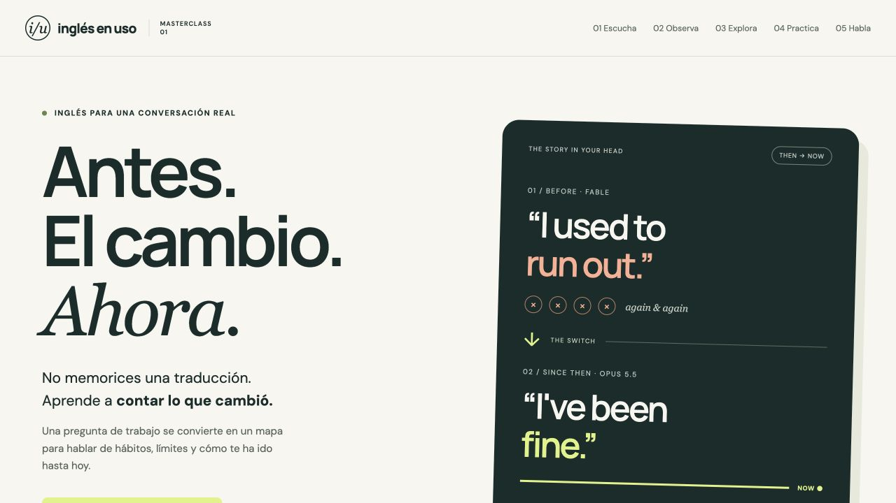

2. **Escucha — buena.** La respuesta está oculta y hay una tarea de comprensión. Los controles de reproducción y velocidad están visibles.

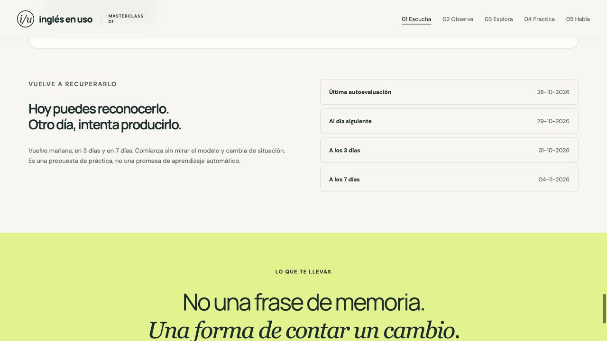

3. **Notar el lenguaje — buena.** Al revelar el texto se distingue el patrón anterior, el cambio y el balance actual sin convertir la conversación en una lista de traducciones.

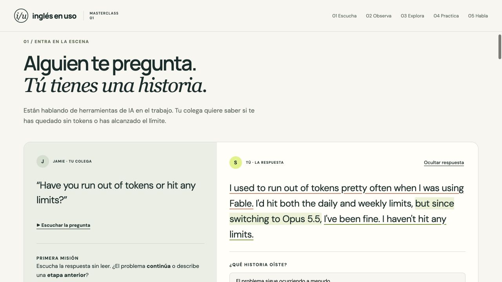

4. **Mapa de la etapa — bueno.** Los corchetes incluyen varios incidentes y apoyan el marco temporal de `was using`. En móvil el contenido fluye verticalmente y las piezas se recorren en una fila desplazable.

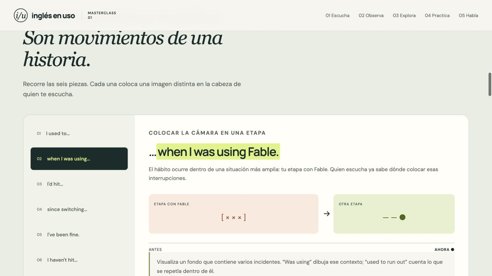

5. **Mapa desde el cambio — bueno.** La continuidad hasta NOW representa el alcance temporal de `since`.

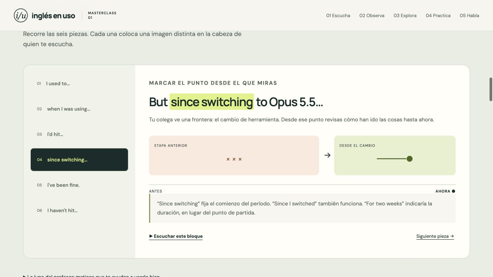

6. **Recurso y tope — bueno.** En 45% queda un 55% de recurso; en 100% el tanque está vacío y la barra llega al límite. El texto inglés cambia con el estado. La nota explica que ambos fenómenos coinciden aquí por simplificación.

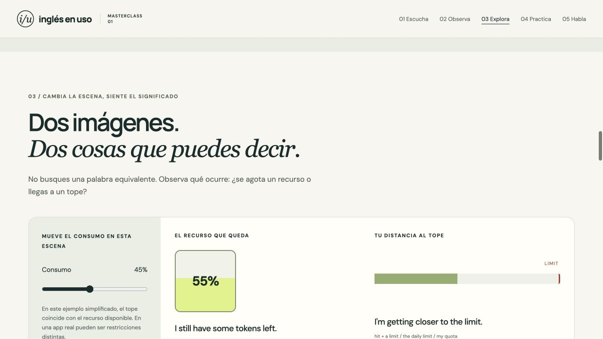

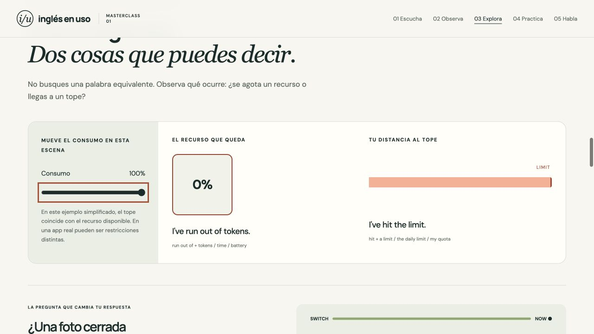

7. **Decidir y corregirse — bueno.** La opción incorrecta sigue a la vista; el feedback explica por qué cuenta un episodio aislado en lugar del patrón pedido. Se puede intentar de nuevo.

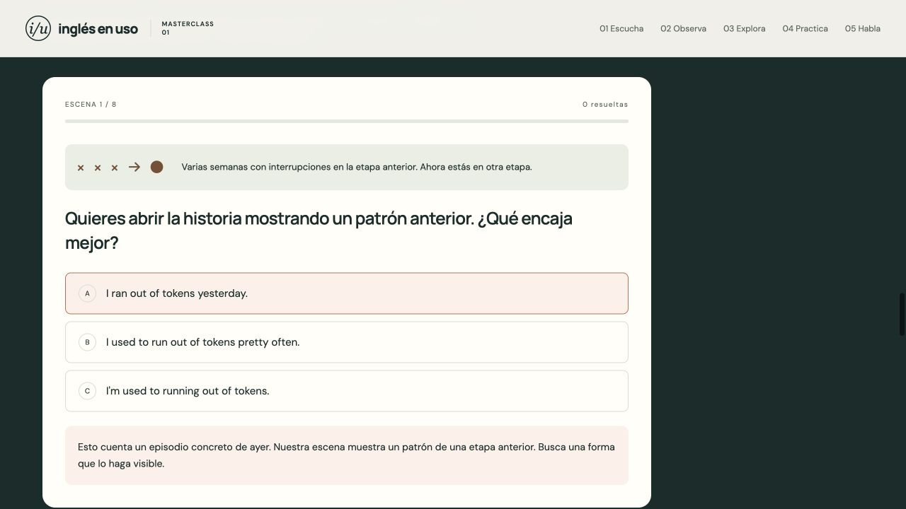

8. **Producir — bueno.** Se muestra una conversación de transferencia, con el modelo cerrado y la opción de hablar sin pistas. La interfaz invita a responder con una versión propia.

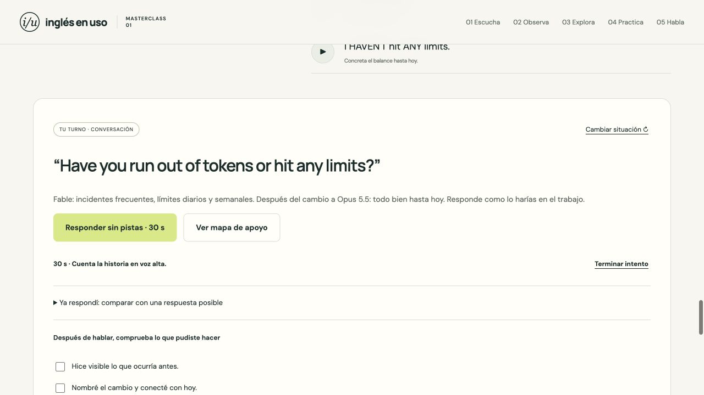

9. **Comparar y autoevaluarse — bueno.** El modelo es una respuesta posible y las casillas se refieren a lo que el alumno pudo comunicar, no a copiar palabras exactas.

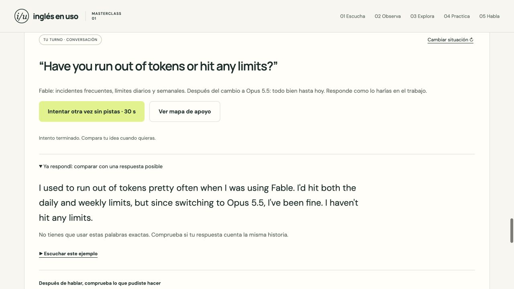

10. **Lectura móvil — buena en las vistas revisadas.** La portada mantiene su jerarquía y el mapa sigue legible sin partir el ejemplo principal.

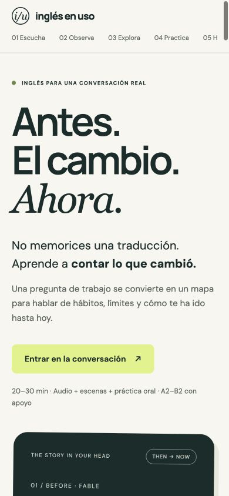

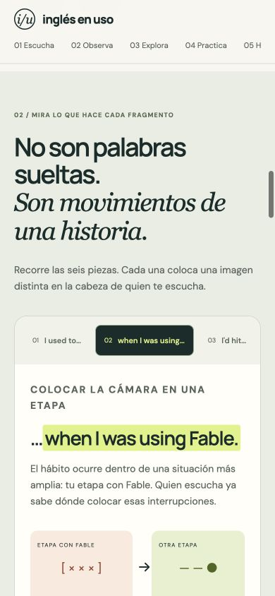

## Mejoras posteriores de menor prioridad

- **Añadir una transferencia autobiográfica.** Después de las situaciones propuestas, pedir al alumno un cambio real de su vida con tres dibujos o notas mínimas, y que haga una pregunta de seguimiento al colega. La producción actual transfiere a contextos nuevos, pero aún recibe todos los hechos desde la página.
- **Comprobar el marco `was using` en una decisión.** Tiene un mapa claro, pero no una pregunta específica entre las ocho. Un contraste entre una fecha aislada y una etapa con varios incidentes permitiría comprobar que el alumno entendió ese uso.

Estas oportunidades amplían la práctica; no son requisitos pendientes para publicar esta lección.

## Límites de esta revisión

Las capturas prueban estados visibles, no aprendizaje retenido. No se ha hecho un estudio con estudiantes ni una comprobación diferida de su producción. La revisión independiente no evaluó acústicamente los archivos de voz ni la pronunciación de un alumno. El agente implementador verificó reproducción, persistencia de las ocho escenas y comportamiento de la autoevaluación; esas comprobaciones se distinguen aquí de la inspección pedagógica y visual independiente.

Se ven texto legible, estados indicados con texto además del color, y una estructura móvil ordenada en las vistas revisadas. El código incluye etiquetas, estados ARIA y tratamiento de movimiento reducido. Esto no certifica accesibilidad completa: faltan una prueba integral con lector de pantalla, ampliación y recorrido de teclado por toda la lección.
