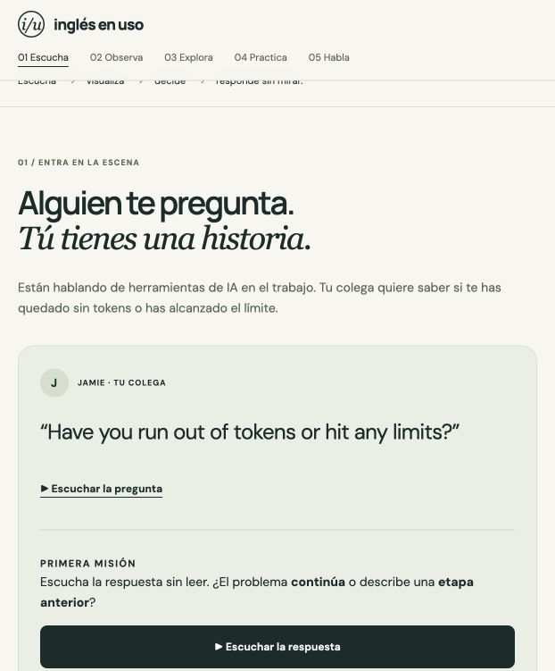
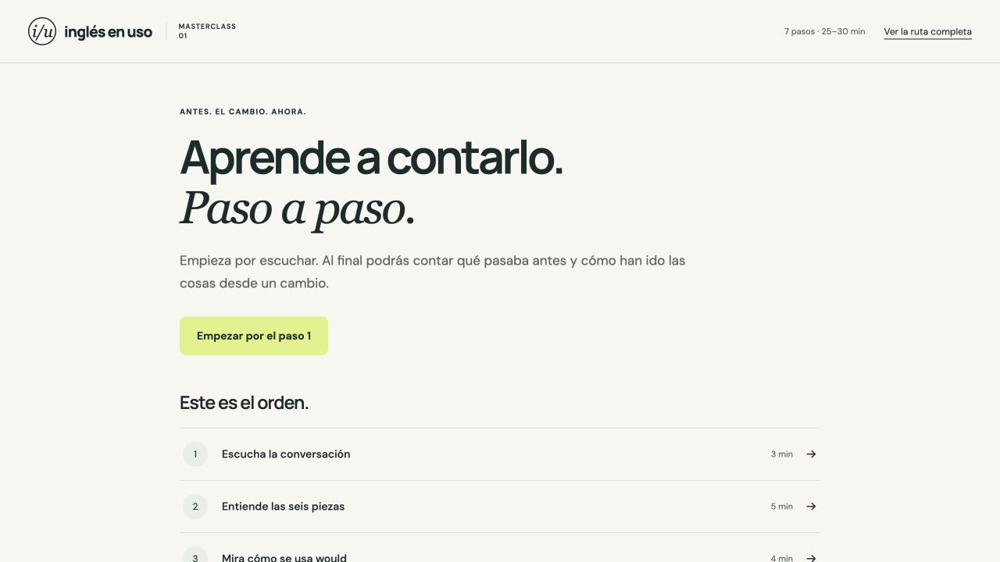
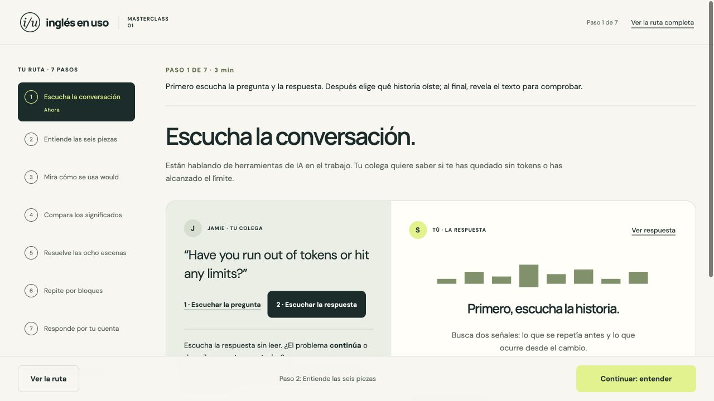
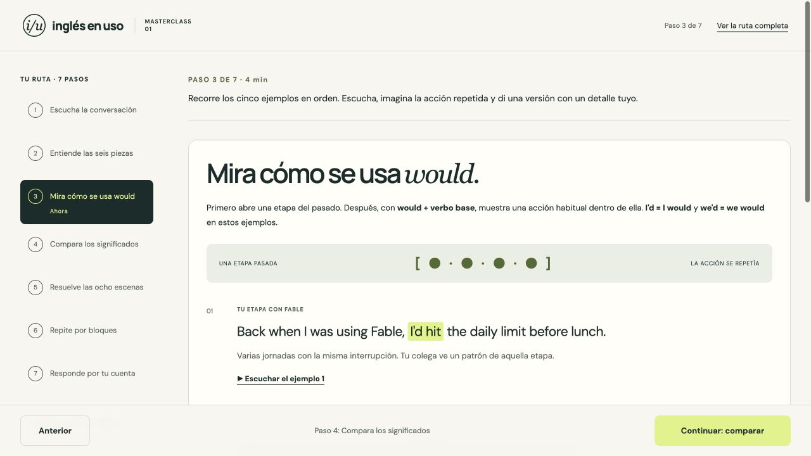
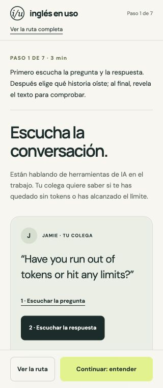
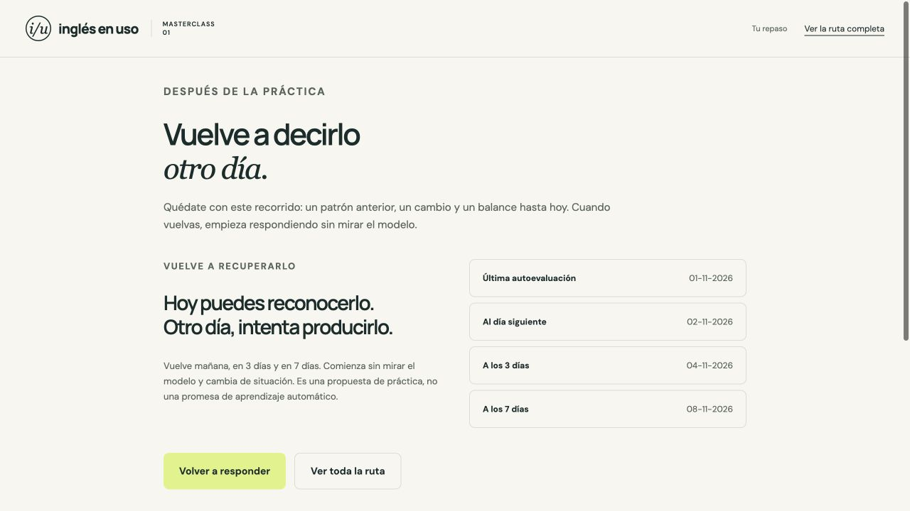

# Ruta guiada: revisión y corrección

Fecha: 1 de noviembre de 2026. Superficie: masterclass de Inglés en uso. Objetivo: que el alumno sepa dónde empezar, qué hacer ahora y qué viene después.

## Lo que se observó antes de editar

Las tres capturas iniciales se tomaron de la página publicada que estaba abierta. Se guardaron e inspeccionaron antes de utilizarlas. La cabecera sí numeraba los apartados; el problema era que la numeración servía como índice de una página larga, sin una transición clara entre actividades.

1. **Escucha:** pregunta, reproducción, comprensión y texto conviven en la misma página larga. No aparece una acción para terminar ese apartado y pasar al siguiente. [Captura inicial de escucha](evidencia/ruta-guiada/01-antes-escucha.jpg).
2. **Explicación:** seis piezas se recorren dentro de un apartado, mientras los ejemplos de would quedan dentro de una nota. La ruta principal y las ampliaciones no tienen una jerarquía clara. [Captura inicial de explicación](evidencia/ruta-guiada/02-antes-explicacion.jpg).
3. **Habla:** el apartado empieza por repetición de bloques; no indica con una transición visible cuándo pasar a responder sin modelo. [Captura inicial de práctica oral](evidencia/ruta-guiada/03-antes-practica-oral.jpg).

## Orden implementado

| Paso | Actividad | Qué prepara |
|---|---|---|
| 1 | Escuchar la conversación | Reconocer el contraste antes/ahora |
| 2 | Entender las seis piezas | Ver qué comunica cada fragmento |
| 3 | Mirar cinco ejemplos de would | Reconocer acciones repetidas en contextos pasados |
| 4 | Comparar significados | Distinguir recursos, topes y períodos |
| 5 | Resolver ocho escenas | Elegir según la intención |
| 6 | Repetir seis bloques | Preparar la producción oral |
| 7 | Responder sin modelo | Transferir y autoevaluarse |

Después del paso 7 aparece el plan de repaso. Los pasos son accesibles desde la ruta completa; la navegación no obliga a demostrar dominio para consultar otro apartado.

## Qué cambió

- Se ve un solo paso cada vez. La cabecera muestra la posición y cada pantalla indica una tarea concreta.
- La portada ofrece un único inicio destacado y muestra los siete pasos en orden.
- Una barra fija mantiene visibles Anterior y Continuar, con el destino siguiente. En escritorio también hay una ruta lateral con el paso actual.
- Los ejemplos de would tienen su propio paso. Los demás matices y ejemplos adicionales se señalan como opcionales.
- Las seis piezas ya no vuelven automáticamente al comienzo: la última conduce a would. La salida del cuestionario lleva a repetición; la repetición conduce a respuesta libre.
- El reproductor está disponible en cualquier paso con audio. Cambiar de paso lo pausa y cierra. Un intento oral activo también se detiene al salir.
- La posición de lectura se guarda separada de las respuestas y autoevaluaciones. Retomar no borra el trabajo previo.
- Se mantienen los enlaces anteriores, incluidos `#would-examples` y `#habla`.

## Verificación de ejecución real

Se hizo el recorrido en un origen local de prueba separado para no borrar el avance del alumno:

- Inicio → pasos 1–7 → repaso, con un único panel visible en cada momento.
- Audio de la conversación, comprensión, las seis piezas y transición a los cinco ejemplos de would.
- Recurso agotado, período cerrado y las ocho decisiones resueltas.
- Seis bloques numerados, respuesta oral, comparación posterior y autoevaluación guardada.
- Fechas de repaso visibles después de guardar el intento.
- Retomar tras recarga, Anterior, Atrás/Adelante del navegador y enlace de salto por teclado. El foco va al encabezado actual.
- Vista de 320 px con ancho del documento de 320 px. La primera captura móvil no reflejaba el viewport estabilizado y fue rechazada; se inspeccionó una recaptura válida.
- Siete pruebas Node aprobadas: cuatro de contenido/audio/progreso y tres de continuidad de la ruta, compatibilidad de enlaces y validación de posición.
- Sin errores de consola durante el recorrido probado. No se regeneraron ni cambiaron los 17 audios de ElevenLabs.

## Límites de la revisión

Las capturas y la interacción comprueban la estructura y el recorrido en el navegador usado. No sustituyen una prueba de aprendizaje con alumnos ni una auditoría completa con lector de pantalla. La comparación a 622 px está incluida en `09-despues-escucha-622.jpg`; las vistas amplias muestran además la ruta lateral.
